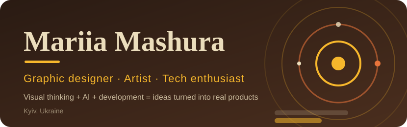

  

  <a href="#-about-me">About</a> ·
  <a href="#-focus-learning-goals">Focus</a> ·
  <a href="#-tools">Tools</a> ·
  <a href="#-lets-connect">Connect</a>
  &nbsp;&nbsp;
  

<table>
<tr>
<td width="58%" valign="top">

### 👤 About me

I'm a graphic designer and artist from Kyiv, Ukraine, and the visual side always comes first for me: composition, color, style, and attention to detail.

I'm also fascinated by development. I'm not a programmer by profession, but an enthusiast: with the help of AI tools I build software, test ideas, and bring them to a working state. My strength is that I can see what the result should look like, set clear tasks, and make decisions, while technology helps me get there faster.

I'm drawn to the role of the person who holds the whole picture: the idea, the look, the logic, and the outcome. That's why I'm growing toward **project and product management**.

</td>
<td width="42%" valign="top">

### ✨ Principles

🎨 **Aesthetics matter.** A good product is both beautiful and easy to use.

🎯 **A clear goal.** First what and why, then how.

🚀 **Results.** An idea is only valuable once it's finished.

📚 **Constant learning.** Every task opens up something new.

🤝 **Openness.** I love sharing knowledge and learning from others.

</td>
</tr>
</table>

### 🔭 Focus, learning, goals

<table>
<tr>
<td width="33%" valign="top">

**Working on**

🖌 Graphics, illustrations, visual concepts 
🤖 Building software and tools with AI assistants and agents 
⚙️ Automating routine work 
🧪 Experimenting with new technologies

</td>
<td width="33%" valign="top">

**Learning**

◻️ Project and product management 
◻️ AI agents and task setting (prompt engineering) 
◻️ Development basics and Git

</td>
<td width="33%" valign="top">

**Goals**

⭐ Combine design, art, and technology in my own products 
⭐ Build a portfolio of finished works 
⭐ Gain experience managing projects and teams 
⭐ Share what I learn

</td>
</tr>
</table>

<table>
<tr>
<td width="50%" valign="top">

### 🛠 Tools

**Design and creativity** 

**AI-assisted development** 

</td>
<td width="50%" valign="top">

### 💬 Let's connect

Open to a collaboration or commission, a project idea, or just a chat about design, art, and technology.

</td>
</tr>
</table>

⭐ If you liked my work, give it a star. It's very motivating!

